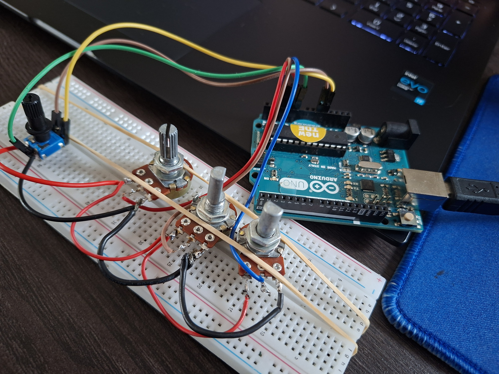

# Arduino Hardware Interface

This directory contains the Arduino firmware used by the Digital Mirror installation.

## Hardware

The Arduino reads four analog inputs:

| Pin | Value |
|---|---|
| A0 | `t` |
| A1 | `l` |
| A2 | `f` |
| A3 | `fk` |

The physical controls connected to these inputs are documented separately.

### Hardware Prototype

The current prototype uses an Arduino Uno connected to four potentiometers through a breadboard.

The potentiometers provide analog input values that are transmitted to the Java orchestrator over USB serial communication.



*Figure 1. Digital Mirror hardware prototype featuring an Arduino Uno and four potentiometers.*

## Serial Communication

- **Baud rate:** 9600
- **Protocol:** Request-response
- **Connection:** USB serial

The Arduino waits for a request from the Java orchestrator before sending sensor readings.

Each response contains four comma-separated integer values followed by a newline.

Example:

```text
512,240,780,100
```

## Integration

The Java `ArduinoSerialService` manages communication with the Arduino.

The firmware does not continuously stream data. It sends readings only when requested by the orchestrator.

## Firmware

Open `DigitalMirrorArduino/DigitalMirrorArduino.ino` in Arduino IDE to inspect or upload the sketch.