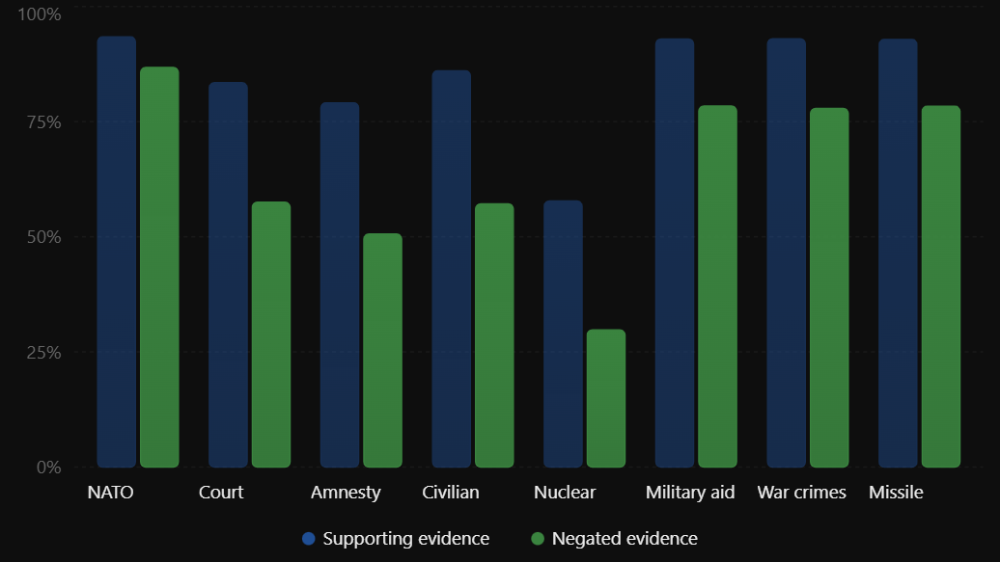

# E10 — Cross-Domain and Negation Testing

**Model:** E06b — TF-IDF + Logistic Regression  
**Datasets:** FEVER, EUvsDisinfo  
**Model status:** Unchanged

## Goal

Check whether our model can understand evidence about real-world disinformation and distinguish between a statement and its negation.

## Experiments and Results

| Test | What we tested | Result |
|---|---|---|
| E10 | 3 real-world claims from EUvsDisinfo | 2/3 correct |
| E10a | 3 versions of evidence about Amnesty International | 1/3 correct |
| E10b | 8 pairs of supporting and negated evidence | 9/16 correct |
| E10b | Prediction changes after negation | Only 1/8 pairs |

## E10b — Negation Sensitivity

**Result:** Only 1 of 8 pairs changed prediction after negation.

## Key Findings

- The model notices negation: adding it reduced `P(SUPPORTS)` in all 8 pairs.
- However, it changed its prediction in only 1 of 8 pairs.
- The average decrease in `P(SUPPORTS)` was **20.26 percentage points**.
- The model often relies on similar words even when the meaning changes.

## Conclusion

E06b performs reasonably well on its original FEVER dataset (77.96% accuracy), but these small tests reveal difficulties with negation and unfamiliar evidence.

The results are diagnostic, not a reliable measurement of overall cross-domain accuracy.

## Next Step — E11

Investigate how the model uses TF-IDF, word overlap, and negation features.

**No retraining yet.** First understand the cause of the errors.